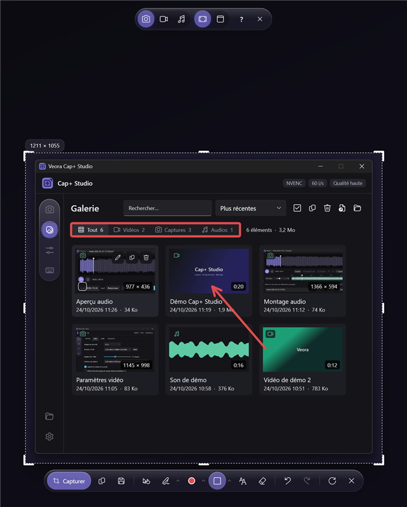
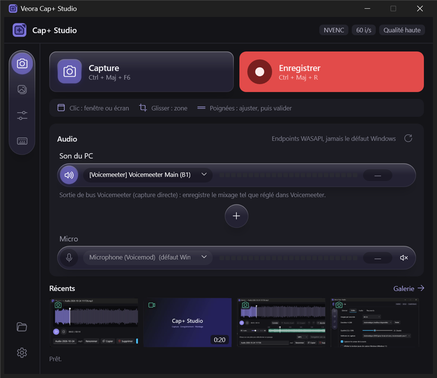
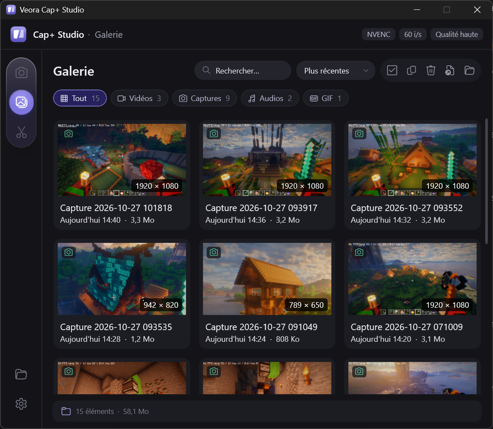
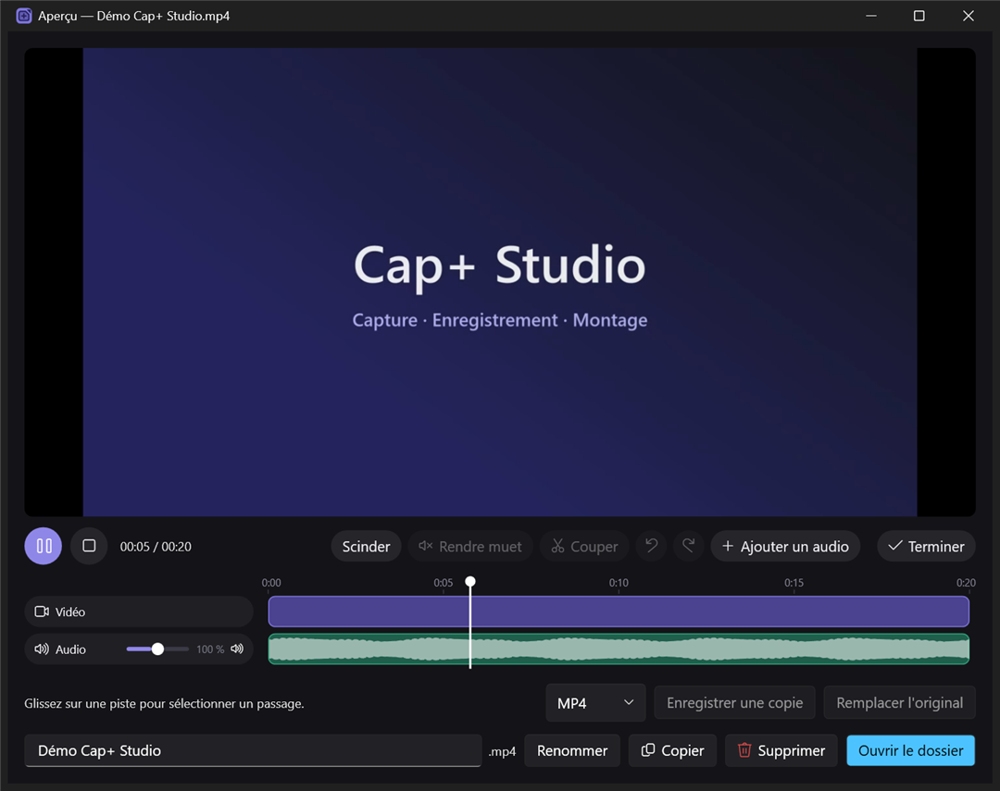
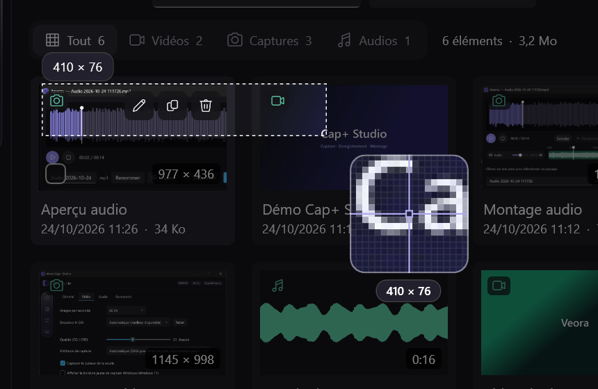
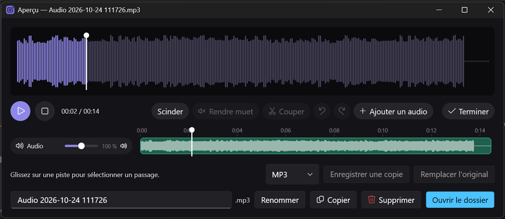
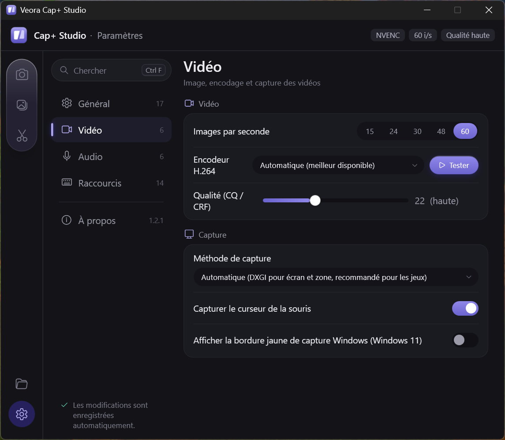

# Veora Cap+ Studio

> 🤖 **Application créée à 100 % par IA** (Claude, d'Anthropic).
> *This app was 100% created by AI (Claude, by Anthropic).*

Capture d'écran, enregistrement vidéo et son, mini montage pour Windows 10 / 11.
*Screenshots, video and sound recording, quick editing for Windows 10 / 11.*

**[⬇ Télécharger / Download](../../releases/latest)**

  
   Barre de capture : sélection, annotation directe, puis Capturer. · <i>Capture bar: select, annotate, capture.</i>

| | |
|---|---|
|  Fenêtre principale : capture, enregistrement, sources audio. · <i>Main window.</i> |  Galerie des vidéos, captures et sons. · <i>Gallery.</i> |
|  Mini montage vidéo : couper, rendre muet, ajouter un son. · <i>Video editing.</i> |  Loupe pour tracer une zone au pixel près. · <i>Pixel-precise magnifier.</i> |
|  Enregistrement et montage du son seul. · <i>Sound-only recording and editing.</i> |  Paramètres : encodeur, qualité, méthode de capture. · <i>Settings.</i> |

## Fonctionnalités

- **Capture d'écran** — une barre de capture (`Ctrl + Maj + F6`) : clic sur une fenêtre ou l'écran, ou glisser une
  zone, avec une loupe pour viser au pixel près. Annotation directe sur la capture (stylo, surligneur, flèche,
  rectangle, rond, texte, gomme), copie dans le presse-papiers.
- **Enregistrement vidéo** — d'une zone, d'une fenêtre ou d'un écran, avec le son du PC et le micro choisis
  séparément (compatible Voicemeeter). Pause, micro coupé à la volée, accélération par la carte graphique (NVIDIA,
  Intel, AMD) ou par le processeur. La vidéo terminée est copiée : `Ctrl + V` pour la coller dans Discord.
- **Son seul** — enregistrement en M4A, MP3 ou WAV.
- **Mini montage** — couper, retirer des passages, rendre muet, volume par piste, ajouter une musique, retirer l'image
  pour ne garder que le son, ajouter une seconde vidéo (par-dessus ou à la suite) ; export en MP4, en GIF animé ou en
  son seul (M4A, MP3, WAV).
- **Galerie** de vos vidéos et captures, raccourcis entièrement personnalisables, discrète dans la zone de
  notification, lancement au démarrage de Windows possible.
- **Français et anglais**, mises à jour automatiques.

### Points forts

- **Le son, sans surprise** : chaque source enregistre exactement le périphérique choisi, sans jamais toucher au son
  par défaut de Windows. Deux sorties du PC peuvent être enregistrées en même temps, en plus du micro.
- **Les jeux à pleine fluidité** : capture à 60 images/s, même en fenêtré.
- **Rien de parasite** : les barres et notifications de l'appli n'apparaissent jamais dans vos captures et vidéos.
- **Légère** : au repos dans la zone de notification, elle ne consomme rien.

## Features

- **Screenshots** — a capture bar (`Ctrl + Shift + F6`): click a window or the screen, or drag an area. Annotate right
  on the capture (pen, highlighter, arrow, rectangle, circle, text, eraser), with a magnifier for pixel-precise areas,
  copy to the clipboard.
- **Video recording** — of an area, a window or a screen, with PC sound and mic picked separately (Voicemeeter
  friendly). Pause, mute the mic on the fly, hardware encoding (NVIDIA, Intel, AMD) or CPU. The finished video is
  copied: `Ctrl + V` to paste it in Discord.
- **Sound only** — record to M4A, MP3 or WAV.
- **Quick editing** — cut, remove parts, mute, per-track volume, add music, remove the image to keep only the sound,
  add a second video (on top or after the end); export to MP4, animated GIF or sound only (M4A, MP3, WAV).
- **Gallery** of your videos and screenshots, fully customizable shortcuts, sits quietly in the notification area,
  can start with Windows.
- **French and English**, automatic updates.

### Highlights

- **Sound you can trust**: each source records exactly the device you picked, without ever touching the Windows
  default. Two PC outputs can be recorded at once, on top of the mic.
- **Games at full smoothness**: 60 fps capture, even in windowed mode.
- **Nothing in the way**: the app's own bars and notifications never show up in your screenshots and videos.
- **Lightweight**: idle in the notification area, it uses no resources.

## Raccourcis / Shortcuts

Tous modifiables dans *Paramètres › Raccourcis*. / All can be changed in *Settings › Shortcuts*.

| Action | Raccourci / Shortcut |
|---|---|
| Barre de capture (photo / vidéo) · *Capture bar (photo / video)* | `Ctrl + Maj + F6` / `Ctrl + Shift + F6` |
| Démarrer / arrêter l'enregistrement · *Start / stop recording* | `Ctrl + Maj + R` / `Ctrl + Shift + R` |
| Pause / reprise · *Pause / resume* | `Ctrl + Maj + F10` / `Ctrl + Shift + F10` |
| Enregistrer une zone · *Record an area* | `Ctrl + Maj + F7` / `Ctrl + Shift + F7` |
| Enregistrer une fenêtre · *Record a window* | `Ctrl + Maj + F8` / `Ctrl + Shift + F8` |
| Enregistrer l'écran · *Record the screen* | `Ctrl + Maj + F9` / `Ctrl + Shift + F9` |
| Couper / rétablir le micro · *Mute / unmute the mic* | `Ctrl + Maj + F11` / `Ctrl + Shift + F11` |
| Afficher la fenêtre · *Show the window* | `Ctrl + Maj + F12` / `Ctrl + Shift + F12` |

## Configuration requise / Requirements

- Windows 11, ou Windows 10 version 2004 ou plus récente, 64 bits. / *Windows 11, or Windows 10 version 2004 or later,
  64-bit.*
- Environ 400 Mo d'espace disque. / *About 400 MB of disk space.*
- Une carte graphique récente accélère l'encodage (NVIDIA, Intel, AMD) ; sinon le processeur prend le relais. /
  *A recent graphics card speeds up encoding (NVIDIA, Intel, AMD); otherwise the CPU takes over.*

## Télécharger / Download

Dernière version / latest version : **[Releases](../../releases/latest)** → `VeoraCapStudio-win-Setup.exe`

- Rien d'autre à installer, aucun droit administrateur. / Nothing else to install, no admin rights needed.
- Les mises à jour arrivent ensuite toutes seules dans l'appli. / Updates then arrive automatically in the app.
- Windows peut afficher « Windows a protégé votre ordinateur » : *Informations complémentaires › Exécuter quand même*.
  / Windows may show "Windows protected your PC": *More info › Run anyway*.

Ce dépôt ne contient que les versions publiées ; le code source est privé.
*This repository only hosts published releases; the source code is private.*

## FFmpeg

Cap+ Studio inclut FFmpeg (build gyan.dev, licence GPLv3), livré tel quel comme programme séparé. Voir
`ffmpeg\LICENSE.txt` et `ffmpeg\COPYING.GPLv3.txt` dans le dossier d'installation. Code source de FFmpeg :
https://ffmpeg.org/download.html

*Cap+ Studio bundles FFmpeg (gyan.dev build, GPLv3 license), shipped unmodified as a separate program. See
`ffmpeg\LICENSE.txt` and `ffmpeg\COPYING.GPLv3.txt` in the install folder. FFmpeg source code:
https://ffmpeg.org/download.html*
