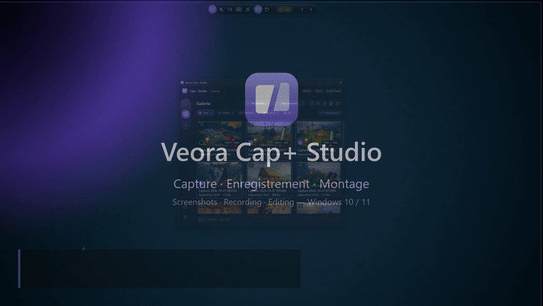
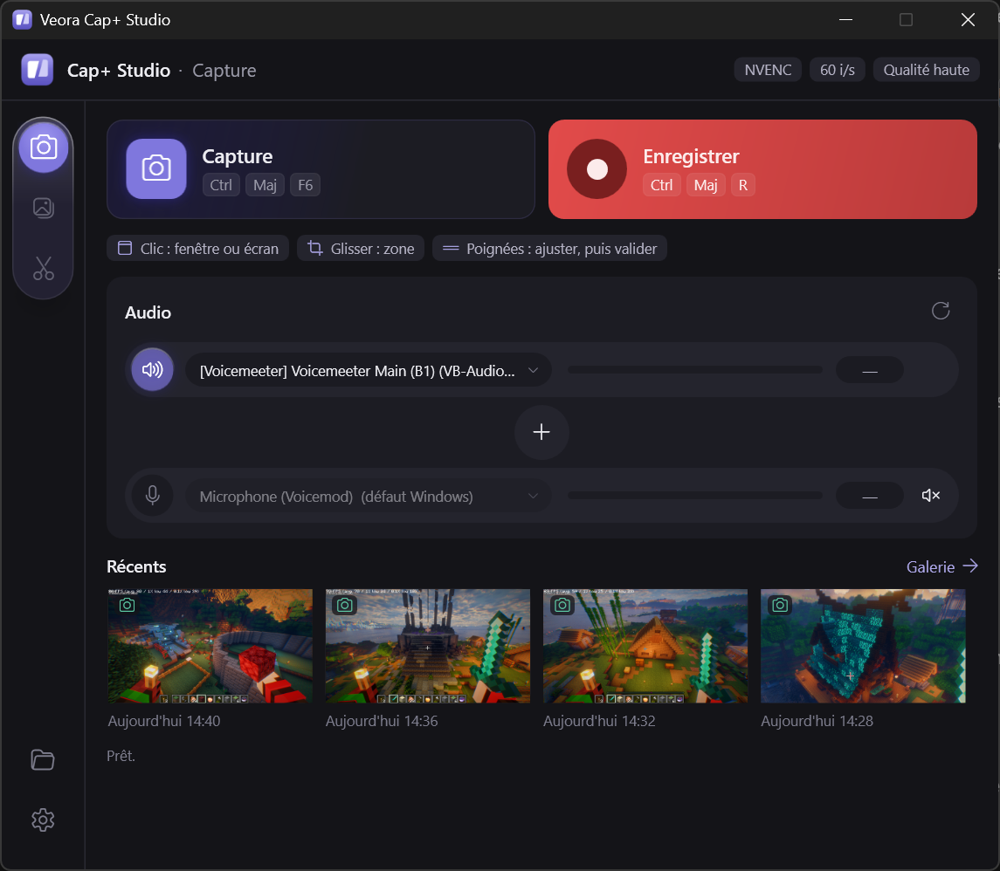
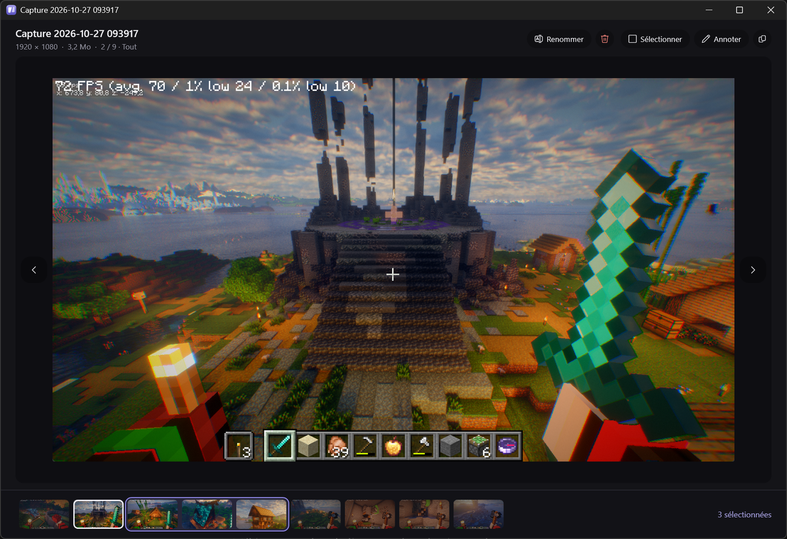
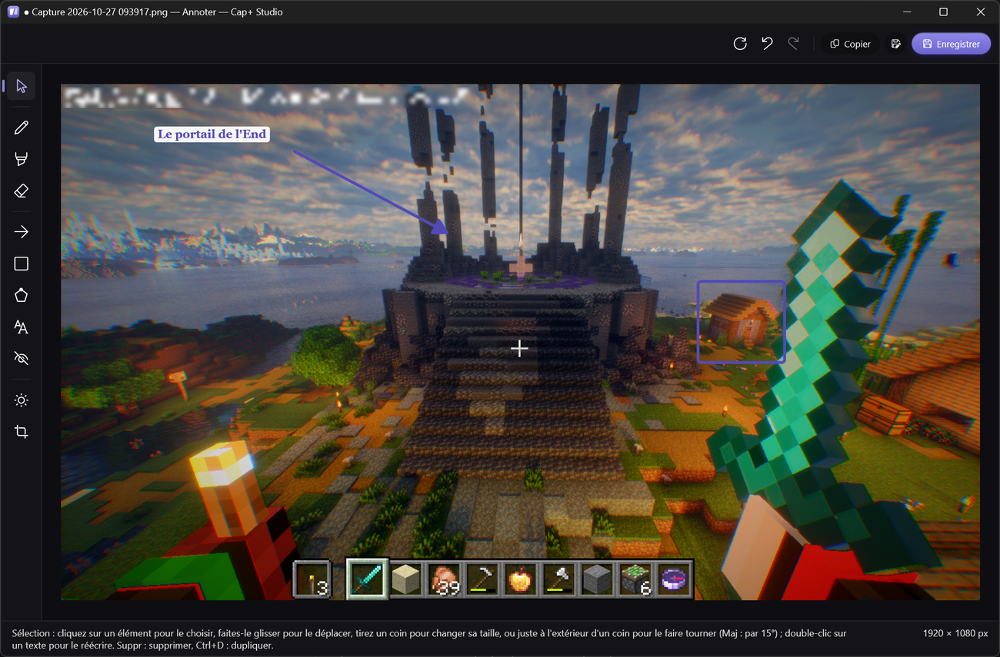
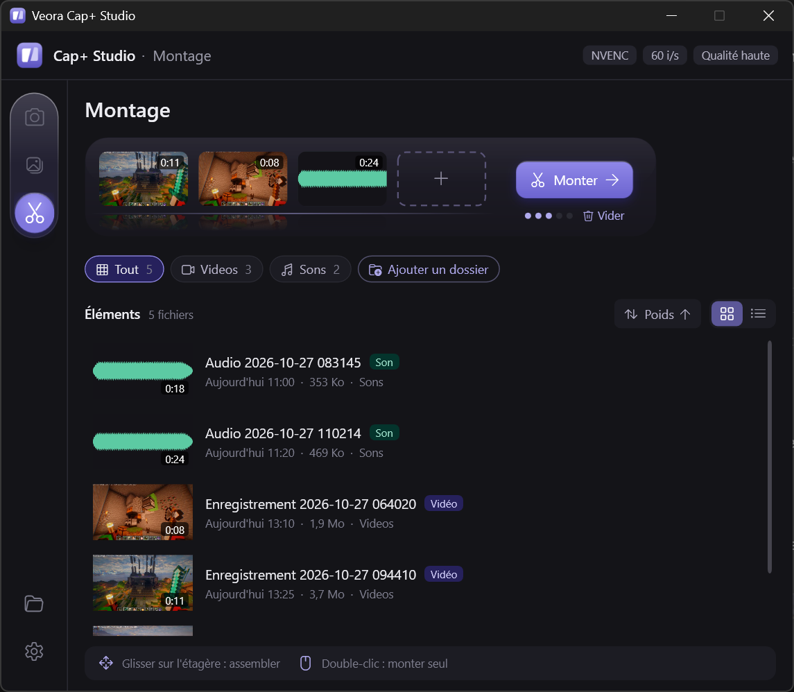
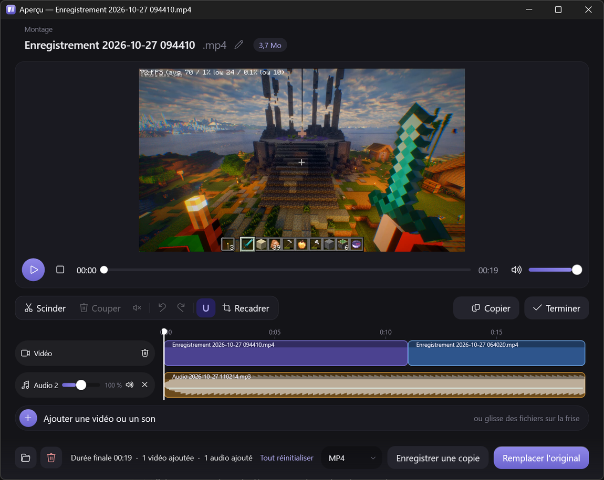
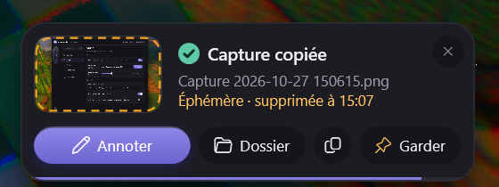

# Veora Cap+ Studio

> 🤖 **Application créée à 100 % par IA** (Claude, d'Anthropic).
> *This app was 100% created by AI (Claude, by Anthropic).*

Capture d'écran, enregistrement vidéo, GIF et son, annotation et mini montage pour Windows 10 / 11.
*Screenshots, video, GIF and sound recording, annotation and quick editing for Windows 10 / 11.*

**[⬇ Télécharger / Download](../../releases/latest)** · **[▶ Vidéo de présentation / Promo video](docs/CapPlusStudio-promo.mp4)**

  
   Tracer une zone, annoter, capturer : la capture arrive dans la galerie. · <i>Draw an area, annotate, capture: it lands in the gallery.</i>

| | |
|---|---|
|  Outil de capture : zone, fenêtre ou écran, annotation directe. · <i>Capture tool.</i> |  Fenêtre principale : capture, enregistrement, sources audio. · <i>Main window.</i> |
|  Galerie des vidéos, captures, GIF et sons. · <i>Gallery.</i> |  Visionneuse : flèches, pellicule, sélection, renommer. · <i>Image viewer.</i> |
|  Annotation : flou, flèches, formes, texte, réglages de l'image. · <i>Annotation editor.</i> |  Étagère du Montage : posez, réordonnez, montez. · <i>Editing shelf.</i> |
|  Montage : scinder, couper, sons, volume, recadrer, export. · <i>Video editor.</i> |  Paramètres : encodeur, qualité, méthode de capture. · <i>Settings.</i> |

  
   Après chaque capture : annoter, ouvrir le dossier, copier — ou garder une capture éphémère. · <i>After each capture.</i>

## Fonctionnalités

- **Outil de capture** (`Ctrl + Maj + F6`) — photo, texte, vidéo, GIF ou son, au choix dans une barre ; clic sur une
  fenêtre ou l'écran, ou glisser une zone, avec une loupe pour viser au pixel près. Une fenêtre cachée passe au
  premier plan au survol, et la **molette** passe aux fenêtres de derrière (jeux fenêtrés compris). Annotation
  directe sur la capture (stylo, surligneur, flèche, formes, texte, gomme), copie dans le presse-papiers.
- **Capture de texte** — un mode Texte lit la zone et surligne les mots : un clic, un glisser ou tout copier.
- **Captures éphémères** — la pastille « Temporaire » envoie la capture (photo, vidéo ou GIF) à la Corbeille après
  1 min à 24 h ; un chrono la suit dans la galerie, et « Garder » la conserve.
- **Enregistrement vidéo et GIF** — d'une zone, d'une fenêtre ou d'un écran, avec le son du PC et le micro choisis
  séparément (compatible Voicemeeter). Pause, micro coupé à la volée, accélération par la carte graphique (NVIDIA,
  Intel, AMD) ou par le processeur. La vidéo terminée est copiée : `Ctrl + V` pour la coller dans Discord.
- **Son seul** — enregistrement en M4A, MP3 ou WAV.
- **Annotation** — un éditeur complet : flou, mosaïque et masquage (avec floutage automatique des e-mails, numéros et
  clés), flèches, rectangles et formes à points (pleins, contour ou pointillés), texte avec les polices de
  l'ordinateur, rotation, sélection, réglages de l'image (teinte, saturation, luminosité, contraste), pression du
  stylet, zoom à la molette, et **Réinitialiser** pour repartir de l'image d'origine.
- **Galerie** — vos vidéos, captures, GIF et sons ; une **visionneuse** pour parcourir les captures en grand ;
  **renommer** comme dans l'Explorateur ; suppression animée en arrière-plan ; glisser une carte vers Discord ou
  l'Explorateur pour envoyer le fichier.
- **Montage** — une étagère où poser jusqu'à 5 vidéos ou sons, que l'on réordonne en les glissant, puis l'éditeur :
  scinder, couper, rendre muet, volume par piste, ajouter une vidéo ou une musique, recadrer ; export en MP4, en GIF
  animé ou en son seul (M4A, MP3, WAV). Tous les GIF s'ouvrent en retouche image par image.
- **Et aussi** — raccourcis entièrement personnalisables, discrète dans la zone de notification, lancement au
  démarrage de Windows possible, **français et anglais**, mises à jour automatiques.

### Points forts

- **Le son, sans surprise** : chaque source enregistre exactement le périphérique choisi, sans jamais toucher au son
  par défaut de Windows. Deux sorties du PC peuvent être enregistrées en même temps, en plus du micro.
- **Les jeux à pleine fluidité** : capture à 60 images/s, même en fenêtré.
- **Rien de parasite** : les barres et notifications de l'appli n'apparaissent jamais dans vos captures et vidéos.
- **Rapide et légère** : l'outil de capture s'ouvre en un clin d'œil ; au repos dans la zone de notification, elle ne
  consomme rien.

## Features

- **Capture tool** (`Ctrl + Shift + F6`) — photo, text, video, GIF or sound, picked in one bar; click a window or the
  screen, or drag an area, with a magnifier for pixel-precise areas. A hidden window comes forward on hover, and the
  **mouse wheel** steps to the windows behind (windowed games included). Annotate right on the capture (pen,
  highlighter, arrow, shapes, text, eraser), copy to the clipboard.
- **Text capture** — a Text mode reads the area and highlights the words: click, drag or copy all.
- **Temporary captures** — the "Temporary" pill sends the capture (photo, video or GIF) to the Recycle Bin after
  1 min to 24 h; a countdown follows it in the gallery, and "Keep" saves it.
- **Video and GIF recording** — of an area, a window or a screen, with PC sound and mic picked separately
  (Voicemeeter friendly). Pause, mute the mic on the fly, hardware encoding (NVIDIA, Intel, AMD) or CPU. The finished
  video is copied: `Ctrl + V` to paste it in Discord.
- **Sound only** — record to M4A, MP3 or WAV.
- **Annotation** — a full editor: blur, mosaic and mask (with automatic blurring of e-mails, numbers and keys),
  arrows, rectangles and point shapes (filled, outline or dashed), text with your computer's fonts, rotation,
  selection, image adjustments (hue, saturation, brightness, contrast), pen pressure, wheel zoom, and **Reset** to
  start over from the original image.
- **Gallery** — your videos, screenshots, GIFs and sounds; a **viewer** to browse captures full size; **rename** like
  in File Explorer; animated deletion in the background; drag a card to Discord or File Explorer to send the file.
- **Editing** — a shelf holding up to 5 videos or sounds, reordered by dragging, then the editor: split, cut, mute,
  per-track volume, add a video or music, crop; export to MP4, animated GIF or sound only (M4A, MP3, WAV). Every GIF
  opens in frame-by-frame retouch.
- **And also** — fully customizable shortcuts, sits quietly in the notification area, can start with Windows,
  **French and English**, automatic updates.

### Highlights

- **Sound you can trust**: each source records exactly the device you picked, without ever touching the Windows
  default. Two PC outputs can be recorded at once, on top of the mic.
- **Games at full smoothness**: 60 fps capture, even in windowed mode.
- **Nothing in the way**: the app's own bars and notifications never show up in your screenshots and videos.
- **Fast and light**: the capture tool opens in a blink; idle in the notification area, it uses no resources.

## Raccourcis / Shortcuts

Tous modifiables dans *Paramètres › Raccourcis*. / All can be changed in *Settings › Shortcuts*.

| Action | Raccourci / Shortcut |
|---|---|
| Outil de capture (photo, texte, vidéo, GIF, son) · *Capture tool* | `Ctrl + Maj + F6` / `Ctrl + Shift + F6` |
| Démarrer / arrêter l'enregistrement · *Start / stop recording* | `Ctrl + Maj + R` / `Ctrl + Shift + R` |
| Pause / reprise · *Pause / resume* | `Ctrl + Maj + F10` / `Ctrl + Shift + F10` |
| Enregistrer une zone · *Record an area* | `Ctrl + Maj + F7` / `Ctrl + Shift + F7` |
| Enregistrer une fenêtre · *Record a window* | `Ctrl + Maj + F8` / `Ctrl + Shift + F8` |
| Enregistrer l'écran · *Record the screen* | `Ctrl + Maj + F9` / `Ctrl + Shift + F9` |
| Couper / rétablir le micro · *Mute / unmute the mic* | `Ctrl + Maj + F11` / `Ctrl + Shift + F11` |
| Afficher la fenêtre · *Show the window* | `Ctrl + Maj + F12` / `Ctrl + Shift + F12` |

## Configuration requise / Requirements

- Windows 11, ou Windows 10 version 2004 ou plus récente, 64 bits. / *Windows 11, or Windows 10 version 2004 or later,
  64-bit.*
- Environ 400 Mo d'espace disque. / *About 400 MB of disk space.*
- Une carte graphique récente accélère l'encodage (NVIDIA, Intel, AMD) ; sinon le processeur prend le relais. /
  *A recent graphics card speeds up encoding (NVIDIA, Intel, AMD); otherwise the CPU takes over.*

## Télécharger / Download

Dernière version / latest version : **[Releases](../../releases/latest)** → `VeoraCapStudio-win-Setup.exe`

- Rien d'autre à installer, aucun droit administrateur. / Nothing else to install, no admin rights needed.
- Les mises à jour arrivent ensuite toutes seules dans l'appli. / Updates then arrive automatically in the app.
- Windows peut afficher « Windows a protégé votre ordinateur » : *Informations complémentaires › Exécuter quand même*.
  / Windows may show "Windows protected your PC": *More info › Run anyway*.

Ce dépôt ne contient que les versions publiées ; le code source est privé.
*This repository only hosts published releases; the source code is private.*

## FFmpeg

Cap+ Studio inclut FFmpeg (build gyan.dev, licence GPLv3), livré tel quel comme programme séparé. Voir
`ffmpeg\LICENSE.txt` et `ffmpeg\COPYING.GPLv3.txt` dans le dossier d'installation. Code source de FFmpeg :
https://ffmpeg.org/download.html

*Cap+ Studio bundles FFmpeg (gyan.dev build, GPLv3 license), shipped unmodified as a separate program. See
`ffmpeg\LICENSE.txt` and `ffmpeg\COPYING.GPLv3.txt` in the install folder. FFmpeg source code:
https://ffmpeg.org/download.html*
